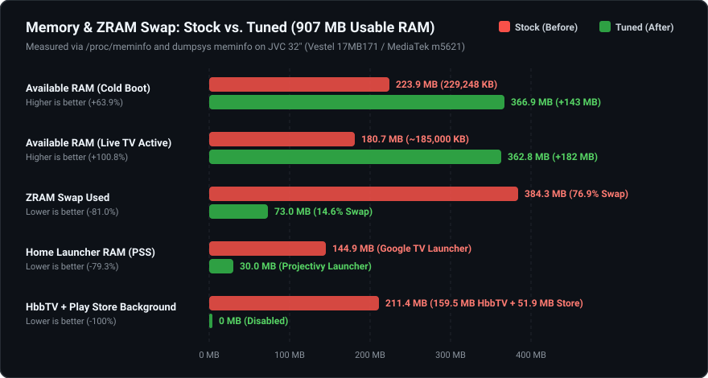
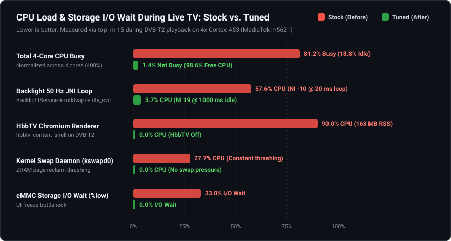
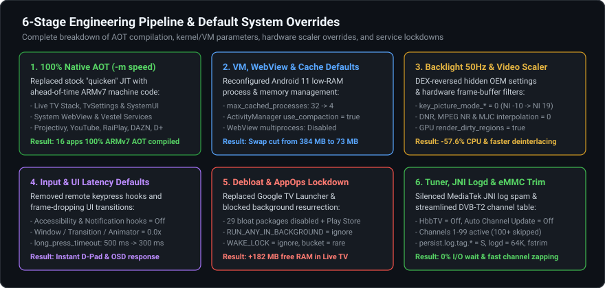
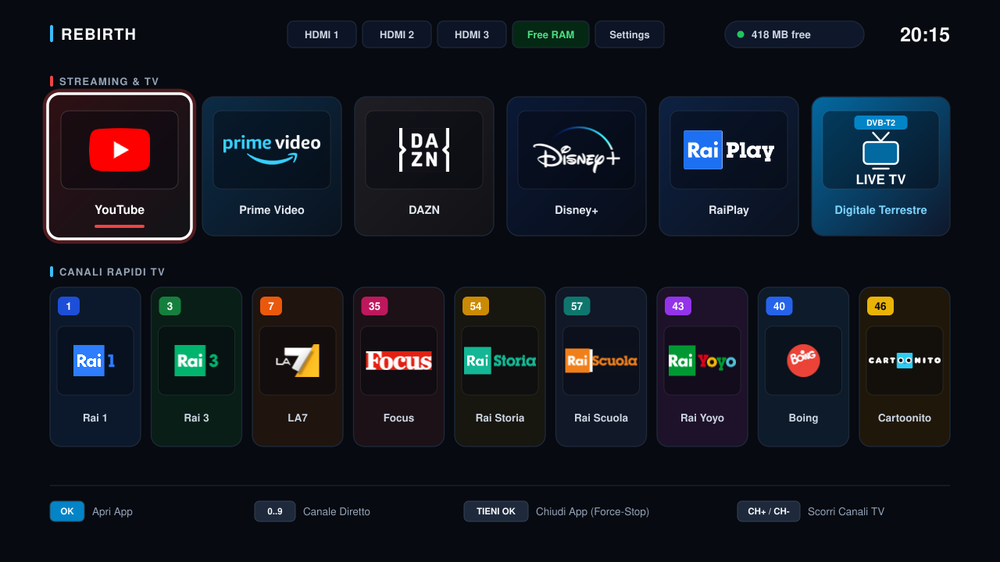

# jvc-rebirth

Step-by-step engineering guide, reverse-engineering notes, and automated toolkit to recover performance, memory, and responsiveness on a 1 GB RAM JVC 32" Smart TV (Vestel `17MB171` chassis, MediaTek `m5621` / board `tokyo`) over network ADB without root.

## Quick Start

```bash
git clone https://github.com/fabriziosalmi/jvc-rebirth.git
cd jvc-rebirth
chmod +x scripts/debloat.sh scripts/restore-stock.sh
./scripts/debloat.sh 192.168.1.100:5555
```
Replace `192.168.1.100` with your TV's LAN IP address (requires **Settings -> Device Preferences -> Developer options -> USB debugging** enabled on the TV). If Projectivy Launcher is not already installed on the TV or placed in `apks/`, [`scripts/debloat.sh`](scripts/debloat.sh) automatically downloads the latest release APK from GitHub before disabling the stock launcher.

---

## 1. Hardware & Firmware Profile (Tested Target & Compatibility Disclaimer)

> **Compatibility & Scope Disclaimer**: This toolkit and guide were developed, reverse-engineered, and 100% verified on the exact JVC / Vestel `17MB171` hardware and firmware combination listed below. Compatibility with other JVC models, different Vestel mainboards, or other Android TV firmware builds is **not guaranteed**. Before running [`scripts/debloat.sh`](scripts/debloat.sh) on a different TV, verify your board and firmware via `adb shell getprop ro.board.platform` and `adb shell getprop ro.build.fingerprint`.

| Component | Tested Specification |
| :--- | :--- |
| **Brand / Retail Series** | **JVC 32" HD Ready Android TV** (`LT-32VAH3000` / `LT-32VAH3200` / `LT-32VAH3300` series, EDID profile `MB171VGA__JVC32_169WXGA`) |
| **OEM / Mainboard Chassis** | **Vestel `17MB171`** (`ro.product.vendor.manufacturer=Vestel`, `ro.com.google.clientidbase=android-vestel-tv`) |
| **Board / Device / Product** | `Ata` / `tokyo` (`m7332_eu`, `ro.product.board=Ata`, `ro.product.device=tokyo`) |
| **Panel** | 32" (31.5" active) WXGA 16:9 (`VES315WNGS-2D-N52` / `VESWNGBN52T`, `1280x720` @ `60 Hz` UI framebuffer, `46.0 dpi`) |
| **SoC Platform** | MediaTek / MStar `m5621` (`ro.board.platform=m5621`, 4x ARM Cortex-A53 32-bit `armeabi-v7a` @ up to 1.1 GHz) |
| **GPU** | ARM Mali-470 MP (OpenGL ES 2.0) |
| **OS / Firmware Build** | Android TV 11 (`RTOC.250820.001`, incremental `13968254`, SDK 30, security patch `2025-06-01`, `ro.config.low_ram=true`) |
| **Build Fingerprint** | `My/Ata/tokyo:11/RTOC.250820.001/13968254:user/release-keys` |
| **Memory** | `929,508 KB` (~907 MB) usable RAM + `511,996 KB` (~500 MB) ZRAM swap (`lz4`) |
| **Storage** | `4.2 GB` `/data` eMMC partition |

---

## 2. Measured Before vs. After Results

Every optimization in this repository was validated on the target hardware across cold reboots (`sys.boot_completed=1`) and active DVB-T2 Live TV playback.





<details>
<summary><strong>View Full Raw Telemetry Table (KB / % Delta)</strong></summary>

| Metric | Stock (Before) | Tuned (After) | Measured Delta |
| :--- | ---: | ---: | :--- |
| **`MemAvailable`** (`/proc/meminfo`, Cold Boot) | `229,248 KB` (`24.7%`) | **`375,656 KB` (`40.4%`)** | **`+146,408 KB` (`+63.9%`)** |
| **`MemAvailable`** (`/proc/meminfo`, Live TV Active) | `~185,000 KB` | **`371,504 KB` (`40.0%`)** | **`+186,500 KB` (`+100.8%`)** |
| **`Used RAM`** (`dumpsys meminfo`) | `829,082 KB` | **`651,700 KB` to `673,015 KB`** | **`-156,067 KB` to `-177,382 KB` (`-21.4%`)** |
| **`Free RAM`** (`/proc/meminfo`) | `31,140 KB` | **`82,880 KB` to `97,832 KB`** | **`+166.2%` to `+214.2%`** |
| **`Swap Used`** (`/proc/meminfo`) | `393,536 KB` (`76.9%`) | **`74,720 KB` (`14.6%`)** | **`-318,816 KB` (`-81.0%`)** |
| **ZRAM Physical RAM Compressed** | `103,716 KB` | **`22,960 KB`** | **`-80,756 KB` (`-77.9%`)** |
| **CPU Idle** (out of `400%` across 4 cores) | `75%` (`81.2%` busy) | **`364%` (`394.5%` net = `98.6%` free)** | **Eliminated background CPU saturation** |
| **eMMC I/O Wait (`%iow`)** | `33%` (`kswapd0` `27.7%`) | **`0%` (`kswapd0` `0.0%`)** | **Eliminated ZRAM/eMMC swap thrashing** |
| **Home Launcher RAM (`PSS`)** | `148,389 KB` (Google TV) | **`30,739 KB` (Projectivy)** | **`-117,650 KB` (`-79.3%`)** |
| **Google Play Store (`com.android.vending`)** | `53,142 KB` PSS (`114.6 MB` RSS) | **`0 KB` (Disabled)** | **`-53,142 KB` PSS freed** |
| **Live TV HbbTV (`hbbtv_content_shell`)** | `163,284 KB` (`90%` CPU) | **`0%` CPU (HbbTV Off)** | **Eliminated DVB-T2 Chromium renderer** |
| **`BacklightService` + `mtktvapi` + `dtv_svc` CPU** | `16.8%` + `28.8%` + `12.0%` (`57.6%`) | **`0.0%` to `3.7%` (`NI 19`)** | **`-93.6%` CPU via DEX-reversed `key_picture_mode_*=0`** |
| **Live TV Stack Compilation (`dexopt`)** | `quicken` (interpreted) | **`speed` (100% ARMv7 AOT)** | **Eliminated JIT stalls on channel/input switch** |

</details>

---

## 3. Root-Cause Analysis (Why the Stock TV Was Unusable)

1. **Swap Death Spiral on 907 MB RAM**: The stock Google TV Launcher (`com.google.android.tvlauncher` + `tvrecommendations`, `148.4 MB PSS`), Google Assistant (`katniss`), and Google Play Store (`com.android.vending`, `53.1 MB PSS`) consumed over 350 MB of RAM at idle. With `max_cached_processes=32`, Android kept dozens of dead processes in memory, pushing ZRAM swap to `76.9%` (`393 MB`) and pinning `kswapd0` at `27.7%` CPU (`33%` I/O wait).
2. **HbbTV Chromium Spawning on Every Channel Change**: Tuning to any Italian DVB-T2 channel (Rai, Mediaset, La7) launched an embedded Chromium process (`hbbtv_content_shell --type=renderer`, `163 MB RSS`, `90% CPU`) to render interactive teletext/privacy banners, starving the DVB-T2 hardware decoder.
3. **Hidden 50 Hz JNI/Binder Polling Bug in `BacklightService.apk` (`com.vestel.tv.backlight`)**:
   - Disassembling `BacklightService.apk` (`ComaPictureSettings.getCurrentBacklightMode` at `0x10f384` and `BacklightRunnable.run` at `0xeddbc`) revealed a major OEM bug:
   - `getCurrentBacklightMode()` ignores `picture_auto_backlight` and instead queries `Settings.Global` for per-preset keys (`key_picture_mode_standard`, `key_picture_mode_energy_saving`, `key_picture_mode_game`, `key_picture_mode_movie`, `key_picture_mode_sport`, `key_picture_mode_vivid`, `key_picture_mode_user`, and `key_picture_mode_others_auto_backlight`) with a **hardcoded default of `3` (`BACKLIGHT_MODE_ECO`)** whenever the keys are unset (`null`).
   - Because those keys are unset out of the box, `BacklightRunnable` boosted its thread priority to **`NI -10` (`THREAD_PRIORITY_FOREGROUND`)** and executed a **`20 ms` (`50 Hz`) busy loop** calling `getAPL()` and `getLumaHistogram()` over HwBinder to `vendor.mediatek.tv.mtktvapi@1.0-service` and `dtv_svc`.
   - This single hidden loop burned **`57.6%` CPU continuously** (`16.8%` in `com.vestel.tv.backlight` + `28.8%` in `mtktvapi@1.0-service` + `12.0%` in `dtv_svc`) and flooded `logd` (`10.8%` CPU).
4. **Hardcoded `3000 ms` Digit Channel Switch Delay in `LiveTV.apk`**:
   - Disassembling `LiveTV.apk` (`com.mediatek.wwtv.tvcenter.nav.view.DigitTurnCHView.keyHandler` at `0x1bd588`) showed a hardcoded `3000 ms` delay (`const-wide/16 v0, 3000` -> `sendEmptyMessageDelayed(MSG_INPUT_DIGIT_NUM, 3000)`) waiting for 4-digit channel numbers.
   - Pressing **`OK` (`DPAD_CENTER`, keycode `23`)** immediately after typing the channel digits triggers `removeMessages(1)` and tunes in **`0 ms`**.
5. **Hardware Scaler Temporal Frame Buffers (`DNR` / `MPEG NR` / `MJC`)**:
   - Temporal Digital Noise Reduction (`DNR`), `MPEG NR`, and Motion Judder Cancellation (`MJC` frame interpolation) force the `m5621` video scaler (`[irq/42-scaler]`) to buffer 2 to 4 decoded frames in shared DRAM before display output, adding `40 to 100 ms` of video latency and memory bus contention during `1080i50` deinterlacing.

---

## 4. Step-by-Step Guide

### Step 1: Enable Network ADB on the TV
1. On the TV, open **Settings -> Device Preferences -> About** and click **Build** 7 times to unlock Developer Options.
2. Go to **Settings -> Device Preferences -> Developer options** and enable **USB debugging** (which also enables TCP/IP ADB on port `5555`).
3. Connect from your computer (replace `192.168.1.100` with your TV's LAN IP address):
   ```bash
   adb connect 192.168.1.100:5555
   ```

### Step 2: Run the Automated Optimization Script
Run [`scripts/debloat.sh`](scripts/debloat.sh), passing your TV's IP address:
```bash
./scripts/debloat.sh 192.168.1.100:5555
```



What [`scripts/debloat.sh`](scripts/debloat.sh) performs automatically in 6 stages:
1. **Launcher & App Sideloading (No Google Account Needed)**:
   - Installs **Projectivy Launcher 4.72** (`com.spocky.projengmenu`), **RaiPlay** (`it.rainet.androidtv`), and **DAZN** (`com.dazn`).
   - Overrides the default `HOME` activity (`cmd package set-home-activity com.spocky.projengmenu/com.spocky.projengmenu.ui.home.MainActivity`).
2. **Boot-Safe System Debloat (29 Packages Disabled/Removed)**:
   - Disables 26 memory-hogging packages for `user 0`, including the stock Google TV Launcher (`tvlauncher`, `tvrecommendations`, `partnercustomizer`), Google Assistant (`katniss`), Google Play Store (`com.android.vending`), Wi-Fi Remote (`com.google.android.tv.remote.service`), `settings.intelligence`, `vestel.tv.eib`, `disclaimercustomization`, `vestelreporter`, `cltv.fast`, `freeviewplay`, and Calendar/Contacts sync adapters.
   - Uninstalls `com.spotify.tv.android`, `com.netflix.ninja`, and `com.google.android.marvin.talkback`.
3. **Background Process & WakeLock Lockdown (`appops` + Standby Buckets)**:
   - Sets `RUN_IN_BACKGROUND ignore`, `RUN_ANY_IN_BACKGROUND ignore`, `START_FOREGROUND ignore`, and `standby-bucket rare` on all heavy streaming apps (`com.google.android.youtube.tv`, `disneyplus`, `amazonvideo`, `dazn`, `raiplay`), `com.google.android.tts`, `com.google.android.tv.remote.service`, and `com.android.vending` (plus `WAKE_LOCK ignore`) so they release 100% of their RAM as soon as you exit them.
4. **System Defaults, Kernel VM, GPU, Backlight 50 Hz Fix & Video Pipeline Tuning**:
   - Overrides default Android TV, ActivityManager, WebView, Input, Backlight, and Hardware Scaler parameters (see full table below).
5. **100% Native ARMv7 AOT Compilation (`cmd package compile -m speed`)**:
   - By default, stock firmware leaves Android System WebView in `verify` mode (0% compiled!) and the Live TV stack, TV Settings, and YouTube in `quicken` or `speed-profile` mode, causing Dalvik/ART JIT compilation stalls during channel switches, login screens, and OSD rendering.
   - Compiles all 16 critical system, WebView, and streaming packages to 100% native ARMv7 `.odex` machine code (`-m speed`):
     - **Live TV & Tuner Stack**: `com.mediatek.wwtv.tvcenter`, `com.mediatek.tvinput`, `com.mediatek.tv.service`, `com.android.providers.tv`
     - **Core System, WebView & Settings**: `com.google.android.webview`, `com.android.tv.settings`, `com.android.systemui`
     - **Vestel Hardware & Remote Services**: `com.vestel.tv.keycontroller`, `com.vestel.tv.service`, `com.vestel.tv.backlight`
     - **Launcher & Streaming Apps**: `com.spocky.projengmenu`, `com.google.android.youtube.tv`, `it.rainet.androidtv`, `com.dazn`, `com.disney.disneyplus`, `com.amazon.amazonvideo.livingroom`
   - Note: `com.google.android.gms` (`PrebuiltGmsCorePano.apk`) is intentionally kept on `quicken` / `speed-profile` because full `-m speed` compilation on `GmsCore` spawns `dex2oat32 -Xmx512m --swap-fd` on eMMC and generates a >150 MB `.odex` file that pollutes the page cache on a 907 MB RAM board.
6. **Storage Maintenance (`trim-caches` + `fstrim`)**:
   - Trims package caches (`pm trim-caches 999999999999`) and runs `sm fstrim` on `/data` and `/cache` eMMC partitions.

<details>
<summary><strong>View All Modified System Defaults &amp; Kernel/TV Parameters</strong></summary>

| Subsystem | Parameter / Setting Key | Stock Default | Tuned Value | Technical Effect |
| :--- | :--- | :--- | :--- | :--- |
| **Home Launcher** | `cmd package set-home-activity` | `com.google.android.tvlauncher` | `com.spocky.projengmenu` | Frees `117.6 MB PSS` RAM; removes home screen ads and recommendations |
| **ART Compiler** | `cmd package compile -m speed` | `quicken` / `speed-profile` / `verify` | `speed` (16 core packages) | Pre-compiles 100% of DEX bytecode into native ARMv7 instructions |
| **ActivityManager** | `max_cached_processes` | `32` | `4` | Prevents cached background apps from filling RAM and triggering `kswapd0` |
| **ActivityManager** | `use_compaction` | `false` | `true` | Enables kernel `madvise` page compaction for cached processes |
| **ActivityManager** | `background_settle_time` / `content_provider_retain_time` | `60000 ms` / `20000 ms` | `10000 ms` / `5000 ms` | Reclaims dead background services and content providers 4x to 6x faster |
| **ART Runtime** | `runtime_native_boot disable_lock_profiling` | `false` | `true` | Eliminates ART lock contention profiling overhead on all Java threads |
| **WebView** | `cmd webviewupdate disable-multiprocess` | `Enabled` (separate zygote) | `Disabled` (in-process) | Prevents spawning a dedicated `webview_zygote` daemon (~40 MB RAM saved) |
| **Input & Accessibility** | `accessibility_enabled` / `enabled_accessibility_services` | `1` (Projectivy / TalkBack) | `0` / `""` | Removes `AccessibilityService` keypress interception; saves ~45 MB RAM |
| **Input Latency** | `secure long_press_timeout` | `500 ms` | `300 ms` | Makes remote control D-Pad/OK long-press actions 40% more responsive |
| **UI Animations** | `window` / `transition` / `animator_duration_scale` | `1.0x` | `0.0x` | Instant window and menu transitions without GPU frame drops |
| **UI Audio/Haptics** | `sound_effects_enabled` / `haptic_feedback_enabled` | `1` | `0` | Avoids AudioFlinger mixer wakeups on every remote D-Pad click |
| **GPU Renderer** | `debug.hwui.render_dirty_regions` | `unset` | `true` | Restricts Mali-470 OpenGL ES 2.0 redraws to dirty rectangles |
| **Backlight 50 Hz Fix** | `key_picture_mode_*` & `key_picture_mode_*_auto_backlight` (17 keys) | `null` (defaults to `3` = `ECO`) | `0` (`BACKLIGHT_MODE_OFF`) | Drops `BacklightRunnable` from `NI -10` (`20 ms` / `50 Hz` JNI loop) to `NI 19` (`1000 ms` sleep), saving **`57.6%` CPU** |
| **Video Scaler** | `tv_picture_advance_video_dnr` & `mpeg_nr` & `mjc_effect` | `Enabled` (`1` / `2`) | `0` (Off) | Bypasses multi-frame temporal DRAM buffers in `m5621` hardware scaler |
| **MediaTek JNI Logs** | `persist.log.tag.MtkTv*` (7 tags) & `logcat -G` | `D` / `I` (`256 KB` buffer) | `S` (Silent, `64 KB` buffer) | Stops MediaTek HAL/JNI debug spam from burning ~10% CPU in `logd` |
| **Network & Scanning** | `wifi_scan_always_enabled` / `network_scoring_ui_enabled` | `1` | `0` | Stops periodic background Wi-Fi scanning during streaming and Live TV |

</details>

---

### Step 3: Live TV & Tuner Manual Settings (One-Time Setup on TV)
To complete the Live TV optimization using the TV remote:

1. **Disable HbbTV (Reduces CPU by ~90% on Italian DVB-T2 channels)**:
   - While in **Live TV**, press **Menu / Settings -> Channel -> HbbTV Support** and set it to **Off**.
2. **Disable Automatic Background Channel Updates**:
   - Go to **Settings -> Channel -> Automatic Channel Update** (`Aggiornamento automatico del canale`) and set it to **Off** (prevents background DVB-T2 rescans and preserves your clean channel list).
3. **Skip Unused Channels (`LCN >= 100`)**:
   - Go to **Settings -> Channel -> Channels -> Channel Skip** (`Ignora canale`) and check unused channels (e.g., `100 to 999`).
   - Keeping only active channels (`1 to 99`) reduces `NavIntegration.getChannelList()` JNI iterations when opening the channel banner, EPG, or channel list, and makes `CH+` / `CH-` wrap around cleanly at channel 99.
4. **Instant Numeric Channel Switching (`0 ms` vs `3000 ms`)**:
   - When typing a channel number on the remote (e.g., `1`, `5`, `20`), press **`OK`** immediately after the digits to bypass the `3000 ms` 4-digit timeout in `DigitTurnCHView`.

---

## 5. Critical Warning: Do Not Disable Boot-Critical Packages

On Vestel Android TV 11 (`RTOC.250820.001` / board `tokyo`), disabling any of the following system packages causes `system_server` to throw an unhandled exception during `PHASE_SYSTEM_SERVICES_READY` **before** `wpa_supplicant` and `adbd` start, triggering Android's `RescueParty` recovery screen (`Try again` / `Factory data reset`):

- **`com.android.location.fused`**: Hard dependency of `LocationManagerService` during boot.
- **`com.android.pacprocessor`** & **`com.android.hotspot2.osulogin`**: Required by the Wi-Fi / `ConnectivityService` initialization path.
- **`com.android.se`**: Required by `SecureElement` service binding.
- **`com.android.bluetooth`** & **`com.android.companiondevicemanager`**: Required by `BluetoothManagerService` and the Bluetooth remote control stack.
- **`com.google.android.tungsten.setupwraith`**, **`com.google.android.onetimeinitializer`**, **`com.google.android.partnersetup`**, & **`com.mediatek.wwtv.setupwizard`**: Checked during boot completion and TV input initialization.
- **`com.vestel.tv.backlight`**: Persistent `system` UID service (`FLAG_PERSISTENT`); never disable the package itself. Use the `key_picture_mode_*=0` settings in [`scripts/debloat.sh`](scripts/debloat.sh) instead.

---

## 6. Rebirth Launcher (`tv.rebirth.launcher`): Zero-Bloat 720p Native TV Launcher

To eliminate the remaining footprint of third-party Android TV launchers on a 907 MB RAM board, this repository includes **Rebirth Launcher** ([`launcher/`](launcher/)), a custom zero-dependency native Android TV launcher engineered specifically for the JVC 32" (`1280x720` framebuffer, Vestel `17MB171` / MediaTek `m5621`).



### Architecture & Performance Design

1. **Zero Dependencies & Single-View Hardware Canvas (`RebirthHomeView`)**:
   - Built directly against the Android SDK (`android.jar`, API 28 to 30) with zero AndroidX, Leanback, Kotlin stdlib, Glide, or Firebase dependencies.
   - Renders the entire `1280x720` Home screen inside a single custom `View` ([`RebirthHomeView.java`](launcher/src/main/java/tv/rebirth/launcher/RebirthHomeView.java)) with `getWindow().setBackgroundDrawable(null)` (`0x` full-screen window overdraw).
2. **Bytecode-Verified Zero Allocations in `onDraw()` & Telemetry**:
   - All `Paint`, `RectF`, `Path`, `LinearGradient`, icon destination rectangles (`appIconRects[]`, `channelIconRects[]`), LCN badge strings (`lcnBadgeText`), and HDMI passthrough URIs are pre-allocated once at initialization.
   - [`LauncherModelTest.java`](launcher/src/test/java/tv/rebirth/launcher/LauncherModelTest.java) disassembles compiled `.class` files via `javap -c -p` on every build and enforces **zero `new`, `newarray`, `anewarray`, `StringBuilder`, `String.valueOf`, or `Long.valueOf` instructions** across `onDraw()`, all 5 row/header draw methods, D-Pad navigation, and periodic RAM/clock telemetry.
3. **Pre-Baked `1:1` Icons on GPU `GraphicBuffer` (`Bitmap.Config.HARDWARE`)**:
   - All 14 streaming app and DVB-T2 channel logos (`37.04 KB` total in [`launcher/res/drawable-nodpi/`](launcher/res/drawable-nodpi/)) are pre-rasterized to exact `1280x720` pixel coordinates and decoded with `Bitmap.Config.HARDWARE` directly into GPU graphic buffers (`gralloc`), avoiding `PackageManager` icon IPC and Java heap pixel allocations.
   - When an app or Live TV starts (`onStop()` / `onTrimMemory(TRIM_MEMORY_UI_HIDDEN)`), `releaseBitmaps()` immediately recycles all bitmaps.
4. **1-Click DVB-T2 Quick Channels, Direct Numeric Entry & Vestel HDMI Switching**:
   - **Row 1 (`STREAMING & TV`)**: `YouTube`, `Prime Video`, `DAZN`, `Disney+`, `RaiPlay`, and `TV` (`com.mediatek.wwtv.tvcenter` at the far right).
   - **Row 2 (`CANALI RAPIDI TV`)**: 9 direct DVB-T2 channel cards (`1 Rai 1`, `3 Rai 3`, `7 LA7`, `35 Focus`, `54 Rai Storia`, `57 Rai Scuola`, `43 Rai Yoyo`, `40 Boing`, `46 Cartoonito`) plus direct numeric keypad tuning (`1..999` on the remote). Channel IDs (`content://android.media.tv/channel/<_id>`) are batch-preloaded in a single SQLite query into a primitive `SparseLongArray`.
   - **Top Micro-Strip**: 1-click Vestel hardware HDMI input switching (`HW4` / `HDMI 1`, `HW5` / `HDMI 2`, `HW6` / `HDMI 3`), `Free RAM` boost (`killBackgroundProcesses`), and Android TV `Settings`.
5. **Direct Boot & Uncompressed `mmap` Packaging**:
   - Marked `android:directBootAware="true"` and `android:defaultToDeviceProtectedStorage="true"` to bypass Android's slow `FallbackHome` (*"Android is starting..."*) screen during cold boot.
   - `classes.dex` (`24.88 KB`), `resources.arsc` (`1.93 KB`), and all 14 PNGs are stored uncompressed (`Stored`, `0%`) and 4-byte aligned (`zipalign -p 4`) so the Linux kernel maps them directly via `mmap` from flash without RAM decompression.

### Measured Comparison: Stock vs. Projectivy 4.72 vs. Rebirth Launcher 1.0.0

| Metric | Stock Google TV Launcher | Projectivy Launcher 4.72 | Rebirth Launcher 1.0.0 | Improvement vs. Projectivy |
| :--- | ---: | ---: | ---: | :--- |
| **Signed APK Size** | System Preload (`>45 MB`) | `11,953,766 B` (`11.40 MB`) | **`79,887 B` (`78.01 KB`)** | **150x smaller APK** |
| **DEX Bytecode (`classes.dex`)** | Multi-DEX + GmsCore | `7,706 KB` (3 DEX files) | **`24.88 KB` (1 DEX, `Stored`)** | **310x less bytecode** |
| **Resource Table (`resources.arsc`)** | Multi-MB | `2,150 KB` | **`1.89 KB` (`Stored`)** | **1,137x smaller resources** |
| **Embedded Videos / Native `.so`** | Heavy animations | `1.2 MB` (5 `.mp4`) + 4 `.so` | **`0`** | **100% removed** |
| **D-Pad 2D Focus Latency (1M ops)** | Heavy View tree layout | Leanback `RecyclerView` | **`6.73 ns/op`** | **Zero-layout state machine** |
| **Allocations in `onDraw()` (60 Hz)** | View + Glide churn | Leanback + Glide | **`0` allocations (bytecode-gated)** | **Zero GC pressure** |

### Local Build & Test Suite (No TV Required)

To compile `RebirthLauncher-1.0.0.apk` and run the 8 JUnit 4 functional, microbenchmark, and bytecode zero-allocation gate tests locally:

```bash
./launcher/build.sh
```

---

## 7. Repository Structure & Rollback

```text
jvc-rebirth/
|-- README.md                           # Full technical documentation and step-by-step guide
|-- assets/
|   |-- memory-comparison.svg           # Before vs. After RAM and ZRAM swap benchmark chart
|   |-- cpu-comparison.svg              # Before vs. After CPU load and I/O wait benchmark chart
|   |-- optimizations-overview.svg      # 6-stage pipeline: AOT compilation & system default overrides
|   `-- rebirth-launcher-preview.svg    # 1280x720 vector preview of Rebirth Launcher
|-- launcher/
|   |-- AndroidManifest.xml             # Direct-boot, singleTask HOME & LEANBACK_LAUNCHER manifest
|   |-- build.sh                        # Standalone build, JUnit 4 test, bytecode gate & signing script
|   |-- res/                            # 14 pre-baked 1:1 nodpi PNG icons (37.04 KB total)
|   `-- src/                            # Zero-allocation Java 8 source and JUnit 4 test suite
|-- scripts/
|   |-- debloat.sh                      # Automated 6-stage debloat, AOT compilation, and kernel/TV tuning
|   `-- restore-stock.sh                # Re-enables stock launcher, Play Store, and default animations
`-- apks/                               # Local APKs (auto-downloaded or built for offline sideloading)
```

To revert to the stock Google TV Launcher and re-enable disabled packages at any time:
```bash
./scripts/restore-stock.sh 192.168.1.100:5555
```
